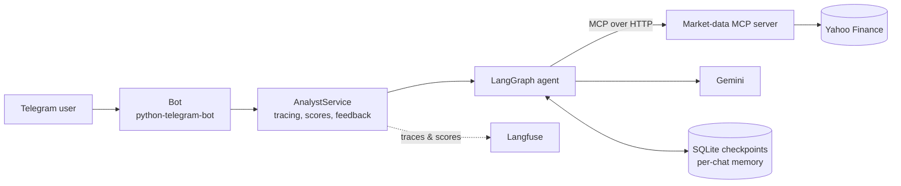
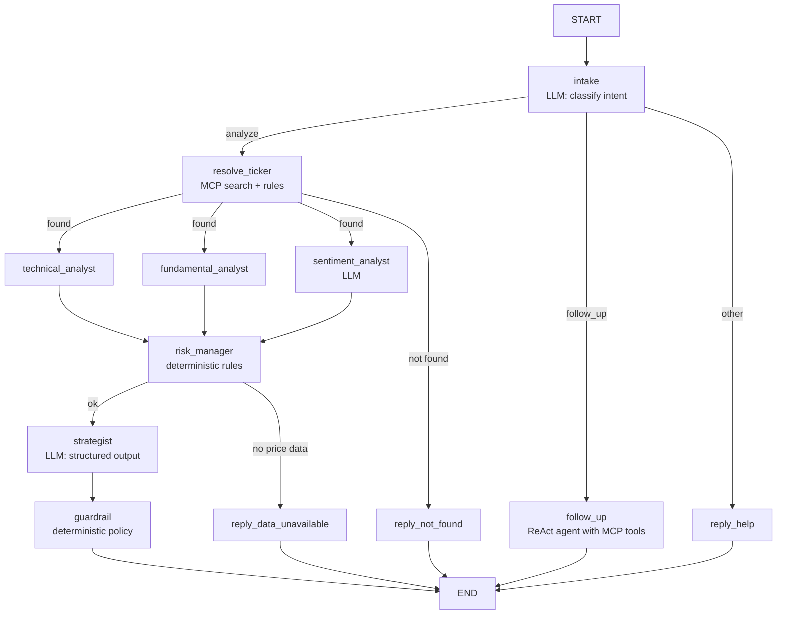

# eq-analyst

An agentic equity research assistant on Telegram. Message it a company name
("how does HDFC Bank look for the long term?") and it resolves the stock, runs
technical, fundamental and news analysis in parallel, applies a rule-based risk policy
and replies with a guardrail-checked recommendation. Follow-up questions ("why?",
"compare it with Infosys") are answered by a tool-using agent with conversation memory.

**Stack:** LangGraph 1.x · Gemini (`langchain-google-genai`) · Model Context Protocol
(official Python SDK) · Langfuse (tracing, prompts, evals) · python-telegram-bot ·
SQLite checkpoints · uv · Docker · GitHub Actions

> Educational project. Not financial advice.

## Architecture



### The agent graph



### Design principles

- **Code computes, the LLM interprets.** Indicators, risk scores, stop losses and
  position sizes are deterministic, unit-tested Python. The LLM is used only where
  language understanding is needed: routing, reading news, writing the thesis.
- **Structured outputs everywhere.** Every LLM call returns a validated Pydantic model;
  no string parsing.
- **Workflow where we need control, agent where we need flexibility.** The analysis is a
  fixed graph; follow-ups use a tool-calling agent bounded by a step limit.
- **Guardrails after the LLM.** Policy rules can override the model (e.g. no BUY on
  CRITICAL risk), and every override is shown to the user and scored in Langfuse.
- **Data behind MCP.** The agent never imports yfinance; any MCP client (Claude Desktop,
  MCP Inspector, another agent) can reuse the market-data tools.
- **Dependency injection.** Nodes receive the LLM and data client via LangGraph's runtime
  context, so the whole graph is tested offline with fakes.

## Quick start

Requires Python 3.11+ and [uv](https://docs.astral.sh/uv/).

```bash
cp .env.example .env          # add GOOGLE_API_KEY and TELEGRAM_BOT_TOKEN
make install
make mcp                      # terminal 1: MCP server on :8000
make bot                      # terminal 2: Telegram bot
```

Or with Docker: `make up`.

**Telegram token:** open [@BotFather](https://t.me/BotFather), send `/newbot`, copy the token.
**Gemini key:** [Google AI Studio](https://aistudio.google.com/apikey).

### Langfuse (optional, recommended)

1. Create a free project at [cloud.langfuse.com](https://cloud.langfuse.com) and put the
   keys in `.env`.
2. `make prompts` uploads the prompts to Langfuse prompt management.
3. Chat with the bot. Each message becomes a trace (grouped per chat as a session) with
   online scores (`risk_level`, `guardrail_triggered`, ...) and 👍/👎 user feedback.
4. `make eval` runs the golden dataset as a Langfuse experiment with deterministic
   checks plus an LLM-as-judge faithfulness score.

### Inspect the MCP server

```bash
npx @modelcontextprotocol/inspector   # connect to http://localhost:8000/mcp (streamable HTTP)
```

## Development

```bash
make check     # ruff + mypy + pytest (what CI runs)
```

The test suite runs the real graph end to end with a fake LLM and fake market data,
so it needs no network or API keys.

## Project layout

```
src/eq_analyst/
  core/            settings (pydantic-settings), structured logging
  domain/          pure logic: models, indicators, signals, risk, guardrails, ticker choice
  mcp_server/      FastMCP server + cached, retrying yfinance client
  agent/           LangGraph state, nodes, routing, prompts, checkpointing, MCP client
  observability/   Langfuse setup
  bot/             Telegram handlers and HTML formatting
  bootstrap.py     composition root: wires real dependencies together
  service.py       application service used by the bot (tracing, scores, feedback)
evals/             golden dataset, evaluators, experiment runner
scripts/           prompt sync
tests/             unit + graph tests with fakes
```
